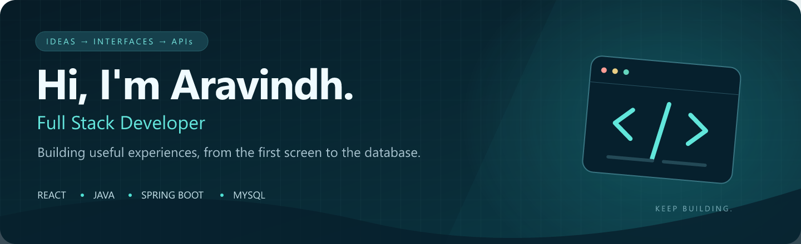
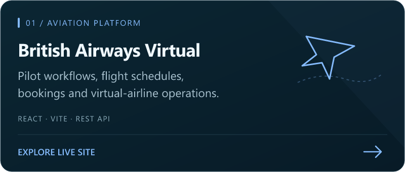
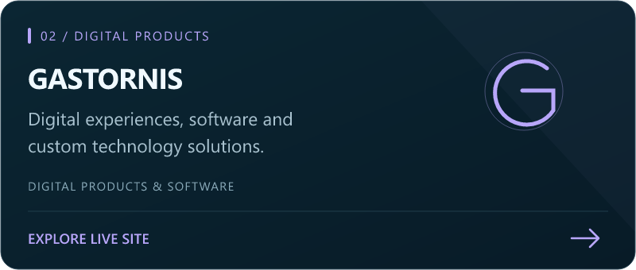
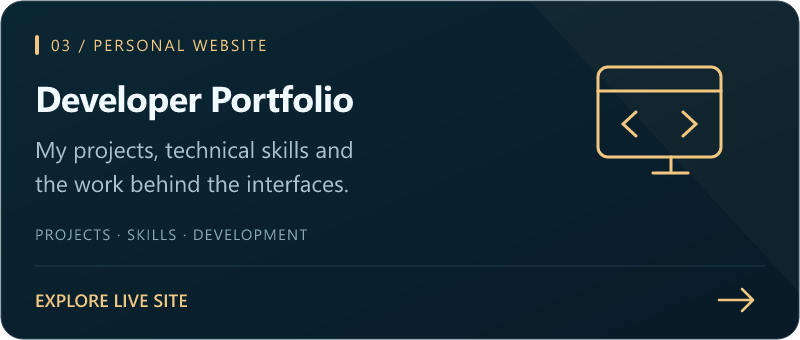
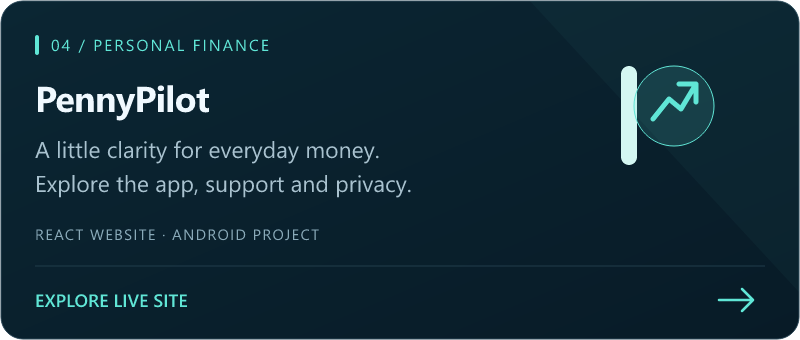

<!-- Upload README.md AND the assets folder to your public Aravindhan-M02 profile repository. -->

  

  
  
  

## A little about me

I'm **Aravindh**, a full stack developer building practical applications with **React, Java, Spring Boot and MySQL**. I enjoy connecting thoughtful interfaces with the APIs and data behind them.

Right now, I'm strengthening my backend development skills, building out **PennyPilot**, and creating digital experiences through **Gastornis**. I learn by building, testing, and improving real projects.

> Thoughtful interfaces. Practical backends. Always something new to build.

## Explore what I've built

Click a project card to open its website.

<table>
  <tr>
    <td width="50%"></td>
    <td width="50%"></td>
  </tr>
  <tr>
    <td></td>
    <td></td>
  </tr>
</table>

<b>✈️ Inside British Airways Virtual — explore the project</b>

 

A virtual airline management platform built with **React**, **Vite**, and a **JSON Server REST API**.

- **Pilot management** — registration and pilot workflows.
- **Flight operations** — scheduling and booking.
- **PIREP workflow** — submission and review of pilot reports.
- **Application management** — pilot applications and administration.
- **Community updates** — news and announcements.
- **Administrative dashboard** — tools for managing platform operations.

[Open British Airways Virtual →](https://british-airways-virtual.onrender.com/)

<b>💸 Inside PennyPilot — the app and its website</b>

 

PennyPilot is my personal finance project: a **Java Android app**, a **Spring Boot / MySQL backend**, and a **React website**.

The work includes income and expense tracking, PDF exports, Google sign-in, account-separated local data, and a membership-gated cloud-sync implementation. Membership purchases and production backend rollout are still upcoming; the public website is available now.

[Explore PennyPilot →](https://pennypilot-website.onrender.com/)

## My development toolkit

| Area | Technologies |
| :--- | :--- |
| **Frontend** | React · JavaScript · HTML · CSS · Bootstrap · Vite |
| **Backend** | Java · Spring Boot · REST APIs |
| **Database** | MySQL |
| **Tools** | Git · GitHub · VS Code · IntelliJ IDEA |

  

<b>🌱 What I'm focused on next</b>

 

- Developing and testing practical Spring Boot APIs.
- Improving database design and reliable data handling.
- Making interfaces clearer, responsive and pleasant to use.
- Taking projects from local development to deployment.
- Preparing PennyPilot's backend hosting and future membership integration.

---

<b>Have an idea in mind? Let's start with a conversation.</b>

<a href="https://portfolio-sh1a.onrender.com/">Explore my portfolio</a> &nbsp; · &nbsp; <a href="https://gastornis.onrender.com/">Visit Gastornis</a>

